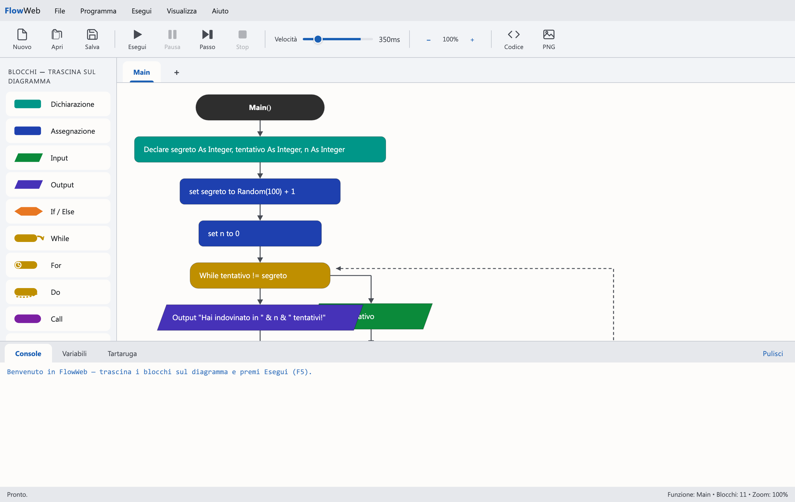
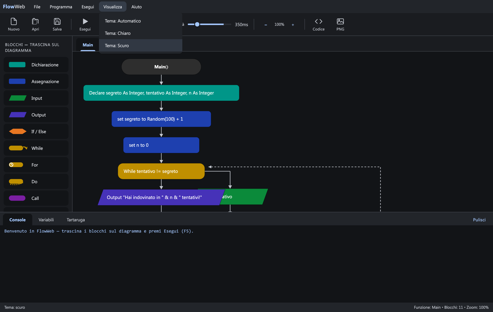

# FlowWeb

A browser-based flowchart IDE inspired by [Flowgorithm](http://flowgorithm.org), packaged as a **single self-contained HTML file**. No server, no install, no dependencies.



<details>
<summary>Dark theme</summary>



</details>

## What it does

FlowWeb lets you design, run, debug and export algorithms as flowcharts — the same workflow Flowgorithm popularized for teaching programming:

- **Visual drag & drop editor** — pull blocks (Declare, Assign, Input, Output, If/Else, While, For, Do, Call, Return, Comment) from the left palette and drop them onto the green insertion lines of the diagram. Double-click a block to edit it, right-click to duplicate or delete. Multiple user functions with parameters and return types, arrays with indexing, and zoom.
- **Interpreter with debugging** — Run (F5), Pause, Step-over (F10), Stop; the block currently executing is highlighted live, a Variables panel watches values as they change, execution speed is adjustable, input is asked through a modal dialog, and runtime errors highlight the offending block.
- **Code generation** — translate the flowchart into Python, JavaScript, C or Java (all four backends are tested: generated code compiles and runs). Export the diagram itself as PNG. Save/load programs as JSON; auto-saved to localStorage.
- **Turtle graphics** — TurtleMove, TurtleTurn, TurtleGoTo, pen up/down, colors, home, clear, show/hide.
- **Material Design 3 theming** — the interface follows Material Design 3 (color roles, elevation, shape, type scale) with light and dark themes, selectable under *View → Theme* (light / dark / auto).

## Getting started

Just open `index.html` in a browser. That's it.

Optionally serve it over HTTP:

```bash
python3 -m http.server 8000
# then open http://localhost:8000
```

Try **File → Examples** for ready-made demo programs (number guessing game, recursive factorial, average of N numbers, turtle spiral), then press F5.

## Tips

- Division between two Integers is **integer division** (like Flowgorithm). Use `ToReal(a) / b` for decimals.
- Concatenate strings with `&`, power with `^`, modulo with `mod`.
- Comparisons use `=`, `!=`, `<`, `<=`, `>`, `>=`; logical operators are `and`, `or`, `not`.
- Built-in functions: `ToInteger ToReal ToString ToChar ToASCII Length Size Char Abs Ceiling Floor Round Sqrt Sin Cos Tan Log Power Random Min Max`.

## Project structure

The app was originally a single self-contained HTML file. It is now split
into small, named modules so the parser, interpreter, codegen and UI each
have a clear home — but **still no build step**:

- **`index.html`** — thin shell. Lists the MD3 stylesheet plus an ordered
  series of `<script src>` tags. Open it directly (`file:///…`) and the app
  runs; no npm, no server.
- **`src/`** — the source files:
  - core logic: `helpers.js`, `i18n.js`, `parser.js`, `model.js`,
    `types.js`, `turtle.js`, `runtime.js`, `run_control.js`, `render.js`,
    `codegen.js`
  - `src/ui/` — chrome, tabs, drag-and-drop, modals, file ops, theme, boot
  - `src/styles/md3.css` — the Material Design 3 tokens

Every `<script src>` runs in markup order and keeps its top-level code in
the global namespace, which is the same contract the original single-file
implementation relied on.

## Tests

```bash
npm install                   # only needed for Playwright / UI checks
node tests/smoke.test.js      # 27 assertions against index.html
node tests/mutation.test.js   # 11 mutants, each targeting one src/ file
```

Mutation testing works by rewriting one source file for the duration of
the smoke run (and restoring it afterwards), so there is exactly one
source tree — no duplicated single-file bundle to keep in sync.

## Mutation testing

`tests/mutation.test.js` proves the smoke suite actually *asserts* the behaviors it exercises, by running the suite against intentionally-broken copies of the app and failing if any break slips past undetected.

The app under test is the inline `<script>` block inside `index.html`, so off-the-shelf runners (Stryker, PIT, …) cannot consume it. The runner does it manually:

1. Reads `index.html` once.
2. For each entry in the `MUTANTS` table applies one localized string replacement. Each `find` snippet must occur **exactly once and must match literally**, otherwise the mutant is reported as `untestable` (a hard failure) so we never silently no-op a misspelled pattern.
3. Writes the mutated doc to `.mutants/<id>.html` (the dir is wiped at the top of every run and is git-ignored).
4. Runs `node tests/smoke.test.js --html <mutant>` synchronously. `tests/smoke.test.js` accepts `--html <path>` (or `FLOWWEB_HTML=<path>`) and defaults to `index.html`.
5. Prints one report line per mutant and a final summary, and exits non-zero if anything survived or was untestable.

### Run

```bash
node tests/smoke.test.js      # 27 assertions against index.html
node tests/mutation.test.js   # 11 mutants × smoke suite
```

### Reading the output

- **KILLED** — the smoke suite failed against the mutated HTML. This is the desired outcome: the tests notice the regression.
- **SURVIVED** — the smoke suite still passed. The tests don't cover the mutated behavior; the runner exits non-zero so CI fails.
- **UNTESTABLE** — the `find` snippet was missing or non-unique in `index.html`. The mutation pattern is stale; the runner exits non-zero.

Each line includes the smoke assertion that killed the mutant (or explains the survivor). A clean run ends with `N killed, 0 survived, 0 untestable`.

## Legal notes

This is an **original, independent implementation**: no Flowgorithm code was decompiled or reused. The interface is merely inspired by Flowgorithm's look & feel (Flowgorithm is a trademark of its respective owners). The `.flowweb.json` file format is specific to this project.
